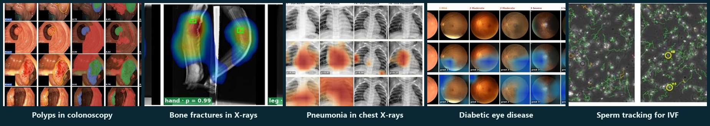

### Engr. Husain Naqvi — medical AI, tested honestly

Biomedical engineer building AI for **medical imaging, cancer genomics and clinical prediction**. Head of Biomedical Engineering at PESSI (Govt. of Punjab) · MS Biomedical Engineering (grade A), Riphah International University · Level 5 National Certified Assessor in AI (NAVTTC) · **Looking for a funded PhD.**

How I work: every model is compared against a published method, checked on data it never saw (another hospital, cohort or cell type), and reported with its failures. Each project below has a results page and a live app you can try without signing in.

#### Medical imaging

| Project | Key result | |
|---|---|---|
| [**MedSeg-AI**](https://github.com/Engr-HusainNaqvi/MedSeg-AI) — polyp segmentation in colonoscopy | Dice 0.885; 0.851 on another hospital's images; 17 ms per frame on one CPU core | [results](https://engr-husainnaqvi.github.io/MedSeg-AI/) · [app](https://polypseg-studio.streamlit.app) |
| [**Fracture-AI**](https://github.com/Engr-HusainNaqvi/Fracture-AI) — fractures in musculoskeletal X-rays | 93.3% held-out accuracy, AUROC 0.94, Grad-CAM | [results](https://engr-husainnaqvi.github.io/Fracture-AI/) · [app](https://fracturescope.streamlit.app) |
| [**Pneumonia-Xray-AI**](https://github.com/Engr-HusainNaqvi/Pneumonia-Xray-AI) — children's chest X-rays | 95.9% accuracy, AUC 0.991; flags its own likely mistakes (AUROC 0.91) | [results](https://engr-husainnaqvi.github.io/Pneumonia-Xray-AI/) · [app](https://pneumonia-xray-ai.streamlit.app) |
| [**Retinopathy-DR-AI**](https://github.com/Engr-HusainNaqvi/Retinopathy-DR-AI) — diabetic eye disease grading | Referral AUC 0.92, expert agreement κ 0.76, ordinal (CORAL) model | [results](https://engr-husainnaqvi.github.io/Retinopathy-DR-AI/) · [app](https://retinopathy-dr-ai.streamlit.app) |
| [**MouseReg-AI**](https://github.com/Engr-HusainNaqvi/MouseReg-AI) — 3D MRI ↔ micro-CT registration | 0.69 mm error, 2 s per pair (ANTs: 88 s), 0% tissue folding | [results](https://engr-husainnaqvi.github.io/MouseReg-AI/) · [app](https://mousereg-studio.streamlit.app) |
| [**Brillouin-AI**](https://github.com/Engr-HusainNaqvi/Brillouin-AI) — how much light Brillouin microscopy needs, vs the Cramér-Rao bound | sim-trained 1D-CNN keeps 0.51 efficiency at 10% light vs 0.13 for Lorentzian fits; 1.7× less light, 10× faster | [results](https://engr-husainnaqvi.github.io/Brillouin-AI/) |
| [**WBC-XAI**](https://github.com/Engr-HusainNaqvi/WBC-XAI) — testing explainable AI for blood-cell images on a second microscope | ViT 0.983 → 0.80 on new microscope; "interpretable" concept models collapse 0.90 → 0.34; 6/11 explainers pass | [results](https://engr-husainnaqvi.github.io/WBC-XAI/) |

#### Cancer and genomics

| Project | Key result | |
|---|---|---|
| [**SpatialTME-AI**](https://github.com/Engr-HusainNaqvi/SpatialTME-AI) — cell types in breast tumours (Xenium ground truth) | r 0.852 vs 0.830 for cell2location, 7 methods compared | [results](https://engr-husainnaqvi.github.io/SpatialTME-AI/) · [app](https://spatialtme-studio.streamlit.app) |
| [**GeneExpr-AI**](https://github.com/Engr-HusainNaqvi/GeneExpr-AI) — DNA sequence → gene-switch activity | r 0.823 (K562), beats published MPRAnn in 10/10 folds | [results](https://engr-husainnaqvi.github.io/GeneExpr-AI/) · [app](https://geneexpr-studio.streamlit.app) |
| [**ImmunoEvo-AI**](https://github.com/Engr-HusainNaqvi/ImmunoEvo-AI) — immunotherapy response, 820 patients, 9 studies | AUC 0.628 on unseen studies vs 0.563 for published TIDE | [results](https://engr-husainnaqvi.github.io/ImmunoEvo-AI/) · [app](https://immunoevo-studio.streamlit.app) |
| [**Biomarker-AI**](https://github.com/Engr-HusainNaqvi/Biomarker-AI) — 14-gene breast cancer outcome panel | C-index 0.720; validated on the US TCGA cohort | [results](https://engr-husainnaqvi.github.io/Biomarker-AI/) · [app](https://biomarker-studio.streamlit.app) |

#### Clinical care and hospital engineering

| Project | Key result | |
|---|---|---|
| [**Sperm-Select-AI**](https://github.com/Engr-HusainNaqvi/Sperm-Select-AI) — sperm tracking and motility for IVF/ICSI | 94.9% agreement with WHO grades; tracking MOTA 0.656 vs 0.461 | [results](https://engr-husainnaqvi.github.io/Sperm-Select-AI/) · [app](https://spermselect-ai.streamlit.app) |
| [**Gait-Outcome-AI**](https://github.com/Engr-HusainNaqvi/Gait-Outcome-AI) — forecasting walking recovery | 19% lower error than no-change baseline; calibrated ranges | [results](https://engr-husainnaqvi.github.io/Gait-Outcome-AI/) · [app](https://gaittwin-gait-recovery.streamlit.app) |
| [**BioMaint-PPM**](https://github.com/Engr-HusainNaqvi/BioMaint-PPM) — hospital equipment maintenance planning | Risk-based (Fennigkoh–Smith) and workload-levelled: busiest day 380 → 6 visits | from my hospital work |
| [**ANN-vs-RNN-Iris**](https://github.com/Engr-HusainNaqvi/ANN-vs-RNN-Iris) — neural networks from the maths up | Hand-derived backprop, gradient error 10⁻⁹, paired statistics | [results](https://engr-husainnaqvi.github.io/ANN-vs-RNN-Iris/) · [app](https://ann-vs-rnn-iris.streamlit.app) |

**Tools:** Python, PyTorch, TensorFlow, scikit-learn, ONNX, Streamlit, Google Colab GPUs.

**Code:** results, figures and write-ups are public; full source and trained models are private and shared on request.

[LinkedIn](https://www.linkedin.com/in/hafizhussain)
